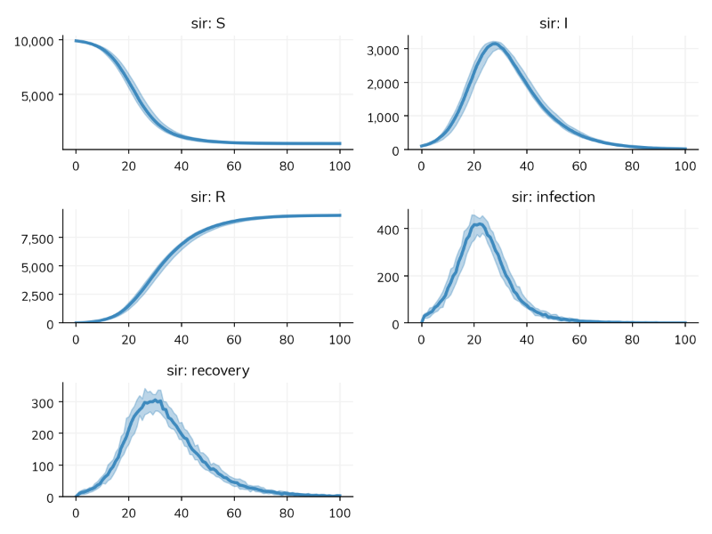

# R-Starsim

[Starsim](https://starsim.org) is a fast, flexible framework for modeling diseases. A model is written as its states (such as susceptible, infectious, and recovered) and the transitions between them, and the same model can be run as a deterministic compartmental model (an ODE), as a stochastic model, or with one agent per person. Starsim can be used to evaluate interventions, project disease burden, fit models to data, and explore transmission dynamics across a wide range of diseases.

R-Starsim makes Starsim available in R. Starsim itself is written in Python; R-Starsim uses [reticulate](https://rstudio.github.io/reticulate/) to run it, so you can write and run models, and work with their results, entirely in R. Full documentation is available at [r.starsim.org](https://r.starsim.org), and for Starsim itself at [docs.starsim.org](https://docs.starsim.org).


## Installation

R-Starsim can be installed from GitHub:

```R
# install.packages("devtools")
devtools::install_github("starsimhub/rstarsim")
library(starsim)
init_starsim()
```

`init_starsim()` installs Starsim, and Python if needed (in a conda environment called `r-starsim`). This only needs to be done once. To update Starsim later, use `reinstall_starsim()`.

If you already have Starsim installed in a Python environment of your own, skip `init_starsim()` and tell R-Starsim where it is, e.g. `load_starsim("my_env")` for a conda environment called `my_env`.


## Example

An SIR model has three states: susceptible (S), infectious (I), and recovered (R). People are infected at a rate of 0.3 per day times the share of people who are infectious, and stay infectious for 10 days on average:

```R
library(starsim)

states("S I R") # Makes the states S, I and R
sir <- Disease(
  infection = Transition(S, I, rate = 0.3 * I),
  recovery  = Transition(I, R, dur = 10),
  init_prev = 0.01 # 1% of people start infectious
)
sim <- Sim(sir, stop = 100)
sim$run()
sim$plot()
```

This runs the model as an ODE. To see how much an epidemic varies by chance, run it 20 times as a stochastic model:

```R
msim <- sim$run(solver = "binomial", n_runs = 20)
msim$plot()
summary(msim)
```



Results are data frames, ready for plotting with ggplot2 or anything else:

```R
df <- as.data.frame(sim)
head(df)
```


## Usage

The most commonly used parts of Starsim are R functions: `Sim()`, `Disease()`, `Transition()`, `states()`, `par()`, `outcome()`, `contacts()`, `vaccinate()`, `modify()`, `parallel()`, `days()`, and `years()`. They take the same arguments as in Python, as R values: e.g. `ss.Sim(sir, stop=100)` in Python is `Sim(sir, stop = 100)` in R.

Everything else in Starsim is in `ss`, as `import starsim as ss` gives in Python: e.g. `ss$SIR()`, `ss$Network()`, or `ss$Sim()` (the same as `Sim()`). Methods are called with `$`: `sim.run()` in Python is `sim$run()` in R.

`plot()`, `as.data.frame()` and `summary()` work on sims, multisims, and results, and plots appear in the R console, RStudio, and R Markdown alike.


## Project structure

| Folder | Description |
|--------|-------------|
| `R/` | Package source code |
| `man/` | Auto-generated documentation (from roxygen2) |
| `vignettes/` | Tutorials and guides (rendered on the docs site) |
| `tests/` | Test suite (testthat) |
| `examples/` | Standalone example scripts |
| `docs/` | Built pkgdown site |


## Contributing

See [CONTRIBUTING.md](CONTRIBUTING.md) for how to set up a development environment, run tests, and submit pull requests.


## Contact

Questions? Comments? Bugs? Please [open an issue](https://github.com/starsimhub/rstarsim/issues/new/choose) or [email us](mailto:info@starsim.org) for help.
