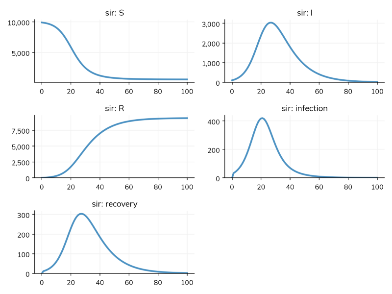
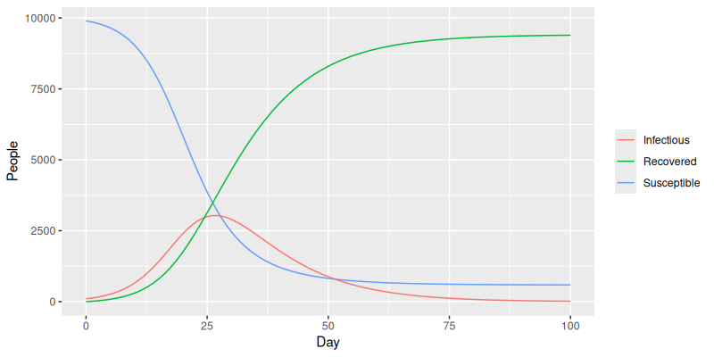

```{r setup, include = FALSE}
knitr::opts_chunk$set(
  collapse = TRUE,
  comment = "#>"
)
```

This tutorial builds a simple epidemic model, runs it, and looks at its results. If you haven't installed Starsim yet, see [Installation](install.html) first.


## An SIR model

In an SIR model, everyone is in one of three compartments: susceptible (S), infectious (I), or recovered (R). People move between them along two transitions:

- **Infection**, from S to I. Each susceptible person is infected at a rate of β times the share of people who are infectious, so the number infected per day is β S I / N.
- **Recovery**, from I to R. People stay infectious for 10 days on average, so they recover at a rate of 1/10 per day.

In Starsim, the compartments are *states*, and each *transition* says where people move from, where they move to, and how fast:

```{r, eval=FALSE}
library(starsim)

states("S I R") # Makes the states S, I and R
sir <- Disease(
  infection = Transition(S, I, rate = 0.3 * I),       # From S to I, at a rate of 0.3 times the share infectious
  recovery  = Transition(I, R, dur = days(10))        # From I to R, after 10 days on average
)
```

A state in a rate, like `I` in `0.3 * I`, is the share of people in it. A duration, like `days(10)`, is the average time spent in a state before leaving it. Since the duration is in days, β = 0.3 is per day, and the basic reproduction number is R0 = β × the duration = 0.3 × 10 = 3. To see the model as equations:

```{r, eval=FALSE}
sir$equations()
#> dS/dt = -beta * S * I / N
#> dI/dt =  beta * S * I / N - I / dur
#> dR/dt =  I / dur
```


## Running it

To run the model, give it to a sim, with how long to run for:

```{r, eval=FALSE}
sim <- Sim(sir, stop = days(100))
sim$run()
#> Sim: sir, 10,000 people, as an ODE, days 0 to 100
#>   sir: R0 = 3, with 100 infectious at the start
#>   Done in 0.0013 s; sir: 9,309 infections; at most 3,036 infectious, on day 27
sim$plot()
```


The sim says what it ran and what happened: 10,000 people (the default population) as an ODE, R0 = 3 as expected, and the size and timing of the peak. By default, 1% of people start infectious; to change this, give the disease `init_prev`, e.g. `init_prev = 0.001` for 0.1%.

`sim$plot()` and `plot(sim)` both plot the results. (At the top level of a script, a plot is shown when it is made; inside a function or loop, use `plot(sim)`, or `print(sim$plot())`, as for a ggplot.)


## Results as a data frame

`as.data.frame()` gives every result, one row per day, with a column for each state and transition:

```{r, eval=FALSE}
df <- as.data.frame(sim)
head(df[, 1:6])
#>   time    sir_S    sir_I    sir_R sir_infection sir_recovery
#> 1    0 9900.000 100.0000  0.00000       0.00000      0.00000
#> 2    1 9867.233 121.7162 11.05107      32.76731     11.05107
#> ...
```

so you can plot them however you like, e.g. with ggplot2:

```{r, eval=FALSE}
library(ggplot2)
ggplot(df, aes(time)) +
  geom_line(aes(y = sir_S, colour = "Susceptible")) +
  geom_line(aes(y = sir_I, colour = "Infectious")) +
  geom_line(aes(y = sir_R, colour = "Recovered")) +
  labs(x = "Day", y = "People", colour = NULL)
```



## Many runs

The ODE gives one answer: the epidemic as expected on average. A real epidemic varies by chance from one outbreak to the next. To see this, run the same model as a stochastic model, in which the number of people who move between states each day is random, and run it many times. `solver = "binomial"` runs it this way, and `n_runs = 20` runs it 20 times, each with its own random seed:

```{r, eval=FALSE}
msim <- sim$run(solver = "binomial", n_runs = 20)
msim$plot()
```


The plot shows the median of the runs, and the range that holds 95% of them. `summary()` gives the same for each result over the whole run (the total of a transition, such as infections, and the final value of a state):

```{r, eval=FALSE}
summary(msim)
#>          result median     low     high    mean      std
#> 1         sir_S  544.5  482.95  610.050  541.05 37.30479
#> 2         sir_I   13.5    6.95   22.525   14.20  4.43396
#> 3         sir_R 9443.0 9377.95 9503.350 9444.75 35.92057
#> 4 sir_infection 9355.5 9289.95 9417.050 9358.95 37.30479
#> 5  sir_recovery 9443.0 9377.95 9503.350 9444.75 35.92057
```

The model can also be run with one agent per person (`solver = "abm"`), which is what a model needs when people differ in ways that compartments can't hold, such as their contacts in a network.


## Next steps

[Age groups, interventions, and fitting](advanced.html) builds on this model. For everything else Starsim can do, see the [Starsim documentation](https://docs.starsim.org): its examples are in Python, but each translates directly to R (see [Using Starsim from R](troubleshooting.html#using-starsim-from-r)).
